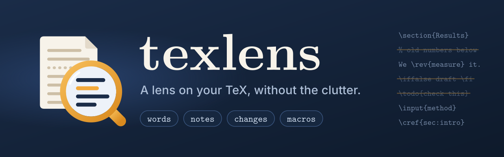

<p align="center">
  
</p>

texlens reads the source of a LaTeX paper to set aside the clutter:
hidden text that never reaches the PDF (`%` comments, `\iffalse ... \fi`
blocks, `comment` environments), notes to coauthors, and markup such as the
labels in `\cref{...}`. Like LaTeX, it follows `\input` and similar commands,
but it does not run LaTeX itself.

Then, texlens can:

- **count words** (`texlens words`) in the abstract and the main text, for
  submission forms that ask for a word count;
- **list notes to coauthors** (`texlens notes`), such as the text of each
  `\todo{...}`, with its file, line, and section;
- **list revised passages** (`texlens changes`), such as the text of each
  `\rev{...}`, section by section, for example to write or check a list of
  changes for a revision;
- **list your macros** (`texlens macros`) and whether they are counted or not.

> [!NOTE]
> **Your paper stays on your computer.** texlens runs locally, makes no
> network connections, and it collects no data. It reads the files of your
> paper without changing them. With `texlens words`, it uses TeXcount, which
> also runs locally; it generates a temporary copy of the counted text and
> deletes it right after (`--keep FILE` saves a copy if you choose to do so).

## Why

[TeXcount](https://app.uio.no/ifi/texcount/), the standard LaTeX word counter
(Overleaf's word count runs it too), counts the source as written. It does
not evaluate conditionals, so it counts hidden text, such as the text in
`\iffalse ... \fi`, in `\if 0 ... \fi`, or under a `\newif` switch set to
false. It also counts notes to coauthors, such as `\todo{...}`, and the
labels in `\cref{...}` and other cleveref commands. Finally, it misses the
words that your own macros print, such as a system name put in
`\newcommand{\sys}{MyTool}`. A paper under revision tends to accumulate
hidden text and notes, so this difference can be large!

texlens generates a copy of your source without the hidden text and
passes it to TeXcount, together with rules for notes, references,
and your own macros.

## Install

texlens needs Python 3.10 or later, and it is not yet on PyPI. Clone this
repository, and install texlens from its directory with
[pipx](https://pipx.pypa.io/), which makes the `texlens` command available
everywhere:

```sh
pipx install .
```

If you do not have pipx: `brew install pipx` on macOS
or `sudo apt install pipx` on Debian and Ubuntu, then `pipx ensurepath`, and
open a new terminal.

Our command `texlens words` needs TeXcount, which comes with most TeX distributions:

- **macOS:** TeXcount comes with [MacTeX](https://www.tug.org/mactex/). If you
  have BasicTeX instead, add it with `sudo tlmgr install texcount`.
- **Linux:** on Debian and Ubuntu, run
  `sudo apt install texlive-extra-utils`. With a TeX Live installed from
  [tug.org](https://www.tug.org/texlive/), run `tlmgr install texcount`.
- **Windows:** TeXcount comes with TeX Live and MiKTeX.

To check that texlens is installed, run `texlens --version`.

## Quick start

In the directory of your paper, run:

```sh
texlens words
```

texlens finds your main file: `main.tex`, or else the only `.tex` file with
`\documentclass`. To choose it yourself, pass it as `texlens words paper.tex`
or `texlens words ~/papers/draft`.

In the same way, run `texlens notes` to list the notes to coauthors,
`texlens changes` for the revised passages, and `texlens macros` for your macros.
Since most papers define custom macros (e.g., `\fixme{...}` for notes),
you can describe them with options or in a
[`texlens.toml`](#configuration) file. See the example below.

## How it works

1. texlens reads the main file and the files that it includes, and drops the
   hidden text (see [Which text texlens skips](#which-text-texlens-skips)).
   It keeps track of the file and line that each remaining line comes from.
2. For `words`, it runs TeXcount on the counted range, preceded by the
   packages that your preamble loads (TeXcount has rules for some of them,
   such as `\textcolor` in xcolor), your own `%TC:` instructions, and
   TeXcount rules for your macros. Where your instructions conflict with the
   settings of texlens, the settings win.
3. For `notes` and `changes`, it finds the calls of your macros, and numbers
   the sections as LaTeX does by default.

## Example

This repository includes a small paper,
[`tests/paper`](tests/paper).
In the example, we define:

```latex
\newcommand{\sys}{Foo}                              % the name of the system
\newcommand{\fixme}[1]{\textcolor{green}{Fix: #1}}  % notes to coauthors
\newcommand{\rev}[1]{\textcolor{blue}{#1}}          % revised text
```

The commands below run in its directory.

### Tell texlens about your macros: `texlens macros`

Start with `texlens macros`. It lists the macros that the paper defines with
`\newcommand`, `\def`, `\NewDocumentCommand`, or similar commands, how
many arguments each takes (`1+1` means one mandatory and one optional
argument), how often the main text uses it, and if `texlens words` counts
it or not.

```console
$ texlens macros
macro          args   uses  treatment
\rev              1      3  arguments counted as text
\fixme            1      1  arguments counted as text
\sys              0      1  no words counted
\finalversion     0      0  no words counted

Configure macros in texlens.toml next to main.tex, or with --note/--change/--ignore/--word.
```

If you do not customize the settings of a macro, then the arguments are counted as text
by default, while a macro without arguments adds no words. In
this example, the notes in `\fixme` are counted, while the word printed by `\sys`
is not. To change this default behaviour, specify a setting:

| Setting | Treatment |
|---|---|
| `--note NAME` | note: not counted |
| `--change NAME` | change: counted |
| `--ignore NAME` | arguments not counted |
| `--word NAME=N` | counts as N words |
| `[macros.rules]` | TeXcount rule ... |

`\todo` is a note, and reference macros such as `\cref` are ignored, without
any setting. [Command-line options](#command-line-options) explains each
setting. With the settings in the example above, the table becomes:

```console
$ texlens macros --note fixme --change rev --word sys=1
macro          args   uses  treatment
\rev              1      3  change: counted
\fixme            1      1  note: not counted
\sys              0      1  counts as 1 word
\finalversion     0      0  no words counted

Configure macros in texlens.toml next to main.tex, or with --note/--change/--ignore/--word.
```

Instead of passing these options every time, write them once in a
`texlens.toml` file next to the main file:

```toml
[macros]
notes = ["fixme"]
changes = ["rev"]

[macros.words]
sys = 1
```

### Count words: `texlens words`

```console
$ texlens words --note fixme --change rev --word sys=1
Counted from \begin{abstract} to \bibliographystyle.
  Words in text:            20
  Words in headings:         3
  Words in captions:         1  (not counted)
  Formulas:                  1  (not counted)
  Word count:               23
```

The word count adds up the lines not marked "(not counted)". Without the three
settings, it would be 25: the three words of the note would be counted, and
`\sys` would not. [What `texlens words` counts](#what-texlens-words-counts)
explains the defaults and how to change them.

### List notes to coauthors: `texlens notes`

`texlens notes` prints the text of every note in the paper: the argument of
each `\todo{...}`, and of each macro with the `--note` setting.

```console
$ texlens notes --note fixme
main.tex:22  [1 Intro]  \fixme
    should not count
sections/method.tex:6  [2 Method]  \todo
    a note
2 notes (\fixme: 1, \todo: 1)
```

Each note shows its file, line, section, and macro, followed by its text.
Notes in hidden text are not listed, since they never reach the PDF. Before
you submit, `texlens notes` should print `0 notes`!

Long notes are cut to one line; `--full` prints them in full, and `--summary`
prints only the number of notes per section.

### List revised passages: `texlens changes`

`texlens changes` prints the text marked by the macros with the `--change`
setting, such as `\rev{...}`:

```console
$ texlens changes --change rev
main.tex:23  [1 Intro]  \rev
    four five
sections/method.tex:2  [2 Method]  \rev
    thirteen fourteen
2 changes (\rev: 2)
```

A `\rev` inside another `\rev` is part of the outer passage: in this paper,
`\rev{thirteen \rev{fourteen}}` is one passage.

With `--summary`, texlens prints only the number of passages in each section,
and an estimate of their words. This helps to write or check a list of
changes:

```console
$ texlens changes --change rev --summary
2 changes (\rev: 2)
  1 Intro: 1 change, about 2 words
  2 Method: 1 change, about 2 words
```

As for `notes`, `--full` prints long passages in full.

## Configuration

### The settings file

texlens reads the settings in `texlens.toml`, next to your main file. All
keys are optional. This example shows every key:

```toml
[macros]
notes = ["fixme"]       # notes to coauthors: not counted, listed by `notes`
changes = ["rev"]       # revised text: counted, listed by `changes`
ignore = ["myref"]      # arguments are not words; "name:2" for two arguments

[macros.words]          # macros without arguments that print words
sys = 1

[macros.rules]          # any TeXcount rule, e.g. for the changes package
replaced = "[text,ignore]"
deleted = "[ignore]"

[conditionals]
false = ["iffinal"]     # conditionals to treat as false
true = []               # conditionals to treat as true
hidden_environments = ["comment"]

[count]
start = ['\begin{abstract}']
stop = ['\appendix', '\bibliographystyle', '\bibliography',
        '\printbibliography', '\begin{thebibliography}', '\end{document}']
footnotes = true        # count footnotes
captions = false        # count figure and table captions
math = false            # count each formula as one word
```

Write macro names without the backslash. Write LaTeX markers in single quotes
(TOML literal strings), so that their backslashes are kept as they are. The
values shown for `hidden_environments` and `[count]` are the defaults. The
macro lists add to the defaults (`\todo` is always a note); the other lists
replace them. A macro can be in only one of `notes`, `changes`, `ignore`, and
`rules`.

### Command-line options

Most settings also have a command-line option. For macros and conditionals,
the options add to the settings file; for the rest, they replace its values.
Options that take a name can be repeated, as in
`--note fixme --note ask`. `texlens <command> --help` lists the options of
each command.

| Option | In `texlens.toml` | Meaning |
|---|---|---|
| `--note NAME` | `[macros] notes` | `\NAME{...}` is a note to coauthors: its text is not counted, and `notes` lists it. `\todo` is always treated this way. |
| `--change NAME` | `[macros] changes` | `\NAME{...}` marks revised text: its text is counted, and `changes` lists it. |
| `--ignore NAME` | `[macros] ignore` | The argument of `\NAME` is not counted, as for a label or a key. Write `NAME:N` for a macro with N arguments. Reference macros such as `\cref`, `\autoref`, and `\eqref` are always ignored. |
| `--word NAME=N` | `[macros.words]` | `\NAME`, a macro without arguments, prints N words: for example, `--word sys=1` for `\newcommand{\sys}{MyTool}`. |
| — | `[macros.rules]` | A TeXcount rule, for macros that the options above do not cover: for example, `deleted = "[ignore]"` for the `\deleted{...}` macro of the changes package. See [TeXcount's documentation](https://ctan.org/pkg/texcount) for the syntax. |
| `--false-if NAME` | `[conditionals] false` | Treat the conditional `\NAME` as false: keep only its `\else` branch. Include the `if`, as in `--false-if iffinal` for `\iffinal`. |
| `--true-if NAME` | `[conditionals] true` | Treat the conditional `\NAME` as true: keep only the text before its `\else`. |
| — | `[conditionals] hidden_environments` | Environments whose content never reaches the PDF (default: `comment`). |
| `--start MARKER` | `[count] start` | Only for `words`: where counting starts, for example `--start '\section{Introduction}'` to skip the abstract. |
| `--stop MARKER` | `[count] stop` | Only for `words`: where counting stops, for example `--stop '\end{document}'` to also count the appendices. |
| `--captions` | `[count] captions = true` | Only for `words`: also count figure and table captions, and margin notes. |
| `--math` | `[count] math = true` | Only for `words`: count each formula as one word. |
| `--no-footnotes` | `[count] footnotes = false` | Only for `words`: do not count footnotes. |
| `--texcount CMD` | — | Only for `words`: run TeXcount with CMD, as in `--texcount "perl /path/to/texcount.pl"`. By default, texlens uses the `TEXLENS_TEXCOUNT` environment variable, or `texcount`. |
| `--keep FILE` | — | Only for `words`: save the text that texlens gives TeXcount, to check what is counted. |
| `--full`, `--summary` | — | Only for `notes` and `changes`: print the texts in full, or only the totals per section. |
| `--config FILE` | — | Read the settings from FILE instead of the `texlens.toml` next to the main file. |
| `--json` | — | Print the result as JSON: an object with the result under the name of the command (as in `"notes": [...]`) and the list of `"warnings"`. |

### Which text texlens skips

As LaTeX does, texlens skips:

- `%` comments;
- the text inside `\iffalse ... \fi` and `\if 0 ... \fi`, keeping the `\else`
  branch, if any (`\iftrue` does the opposite, and `\unless` reverses
  either);
- the text under a switch defined with `\newif` and set to false: after
  `\newif\ifdraft` and `\draftfalse`, the text inside `\ifdraft ... \fi`
  (switches defined with `\let\ifdraft\iffalse` work too);
- the conditionals that you declare with `--false-if` and `--true-if`;
- the content of `comment` environments, of the environments hidden with the
  comment package's `\excludecomment`, and of those in `hidden_environments`;
- the files that `\includeonly` leaves out.

To find all the text, texlens follows `\input`, `\include`, `\subfile`,
`\import`, and `\subimport`. Of an included file that is a document of its
own (with the standalone or subfiles packages), it keeps only the text
between `\begin{document}` and `\end{document}`. It leaves verbatim text,
such as `\verb` and the content of `verbatim`, `lstlisting`, `minted`, and
`filecontents` environments, as it is. texlens warns when a conditional or a
`comment` environment is still open at the end of a file, and handles it as
LaTeX does.

### What `texlens words` counts

- **Range.** texlens counts from the first start marker (by default,
  `\begin{abstract}`, or `\begin{document}` if there is no abstract) to the
  first stop marker after it (by default, the first of the markers listed
  under `stop` in [the settings file](#the-settings-file)). Thus, the title,
  the authors, the references, and the appendices are not counted. Neither
  are keywords and ACM's classification concepts (`\ccsdesc`) and dates
  (`\received`), even when they come after the abstract; ACM's teaser figure
  counts as a figure. The first line of the output shows the markers that
  texlens used.
- **Counted.** The words in the text, including footnotes, and in headings.
  As in TeXcount, the title of the abstract counts as a heading word, and a
  URL counts as one word if the preamble loads hyperref or url.
- **Not counted, unless you ask.** Figure and table captions and margin
  notes (`--captions`), and formulas (`--math`, which counts each formula as
  one word).
- **Never counted.** The content of tables (`tabular`), as in TeXcount; code,
  both inline (`\verb`, `\lstinline`) and in listings; and the ACM
  classification codes (`CCSXML`), which LaTeX does not print.
- **`%TC:ignore`.** As in TeXcount, the text between `%TC:ignore` and
  `%TC:endignore` is not counted. texlens warns when such a region hides more
  than about 20 words outside figures and tables, which usually means that
  `%TC:endignore` is missing or in the wrong place.

For everything else, TeXcount's own rules apply.

## Limitations

- **Other conditionals.** Some conditionals depend on information that
  texlens does not have: for example, `\ifpdf` depends on the TeX engine, and
  `\ifx\a\b` compares two macros. texlens keeps the text of both branches,
  unless you declare the conditional, as with `--true-if ifpdf` if you
  compile with pdfLaTeX. etoolbox toggles and booleans, such as
  `\iftoggle{draft}{...}{...}`, always keep both texts: they take the texts as
  arguments instead of ending with `\fi`, so they cannot be declared.
- **Switches set by macros.** texlens follows a `\newif` switch through the
  `\...true` and `\...false` commands written in your files, outside macro
  definitions. If one of your macros sets the switch, as in
  `\newcommand{\finalversion}{\draftfalse}`, texlens cannot know whether or
  when that macro runs, so it ignores the change. The same holds for switches
  set in a class, in a package, or on the command line. In these cases,
  declare the switch with `--true-if` or `--false-if`.
- **Section numbers.** In the output of `notes` and `changes`, texlens
  numbers the sections by counting `\section`, `\subsection`, and so on, as
  the standard classes do. If your class or preamble numbers them differently
  (for example, IEEEtran uses Roman numerals, and `\setcounter{section}{...}`
  changes the count), these numbers can differ from those in the PDF. File
  names and line numbers are always exact.

## Testing

The tests use Python's built-in `unittest` module. From the repository, run:

```sh
python -m unittest discover -s tests -t .
```

The tests cover:

- **reading a project:** following `\input`, `\include` (with
  `\includeonly`), `\subfile`, `\import`, and `\subimport`; missing,
  self-including, and deeply nested files; line endings and encodings;
  comments and escaped `%` signs; all the conditionals above, nested,
  declared, unclosed, or inside macro definitions, and macros that only look
  like conditionals; hidden and verbatim environments; and finding the main
  file;
- **listings:** finding macro calls with optional, multiple, and nested
  arguments, outside verbatim text; reading macro definitions; numbering
  sections, including starred sections, appendices, and the abstract;
  skipping notes in hidden text; and the table of macros;
- **settings:** the defaults, `texlens.toml` files (including invalid or
  contradictory ones), and command-line options;
- **word counts:** the counted range, the settings and rules given to
  TeXcount, `%TC:ignore` regions, and, with TeXcount, the counts of the test
  paper and of a paper without hidden text, which must equal TeXcount's own;
- **the command line:** the output of each command, `--summary` and
  `--json`, warnings, and errors such as a missing main file or a missing
  TeXcount.

The tests that run TeXcount are skipped if it is not installed; set
`TEXLENS_REQUIRE_TEXCOUNT=1` to make them fail instead. To use a specific
copy of TeXcount, set `TEXLENS_TEXCOUNT`, as described under
[Command-line options](#command-line-options). On Python 3.10, the tests that
read `texlens.toml` files need the tomli package, which `pip install .`
installs.

All tests pass with TeXcount 3.1.1 on Linux (Ubuntu 24.04), with Python 3.10
to 3.13, and on macOS 26, with Python 3.11. texlens has not been tested on
Windows yet.

## Contributing

Bug reports and pull requests are welcome, including new features that you
would find useful. A pull request should add tests for what it changes and
pass the whole test suite (see [Testing](#testing)), which GitHub also runs
on every pull request.

## License

Copyright 2026 Roberta De Viti.

texlens is released under the [Apache License 2.0](LICENSE). You may use,
modify, and redistribute it, also in proprietary software. If you
redistribute it, modified or not, include the [LICENSE](LICENSE) and
[NOTICE](NOTICE) files, keep the copyright notices, and mark the files that
you change. Contributors also grant you a license to any of their patents
that texlens would otherwise infringe.

texlens runs [TeXcount](https://app.uio.no/ifi/texcount/), by Einar Andreas
Rødland, which is distributed separately under the LaTeX Project Public
License. texlens is not affiliated with TeXcount.
